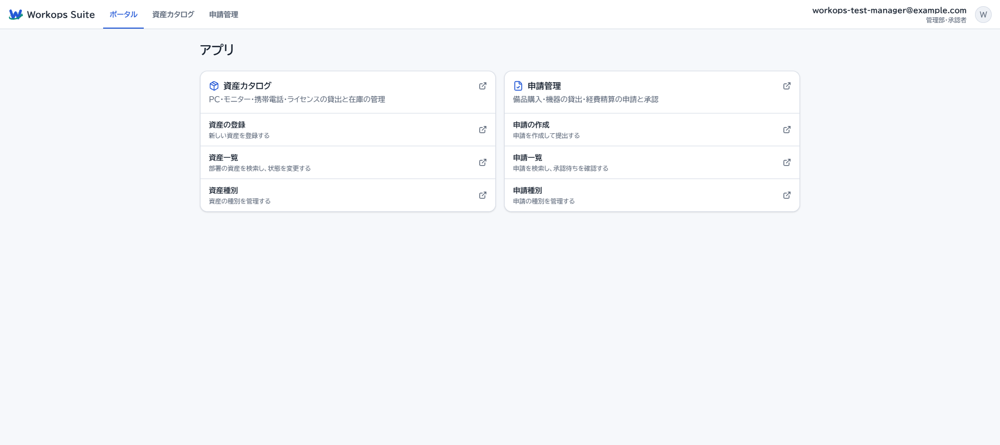
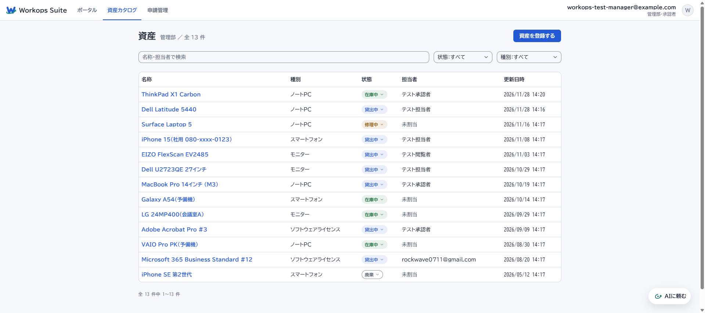
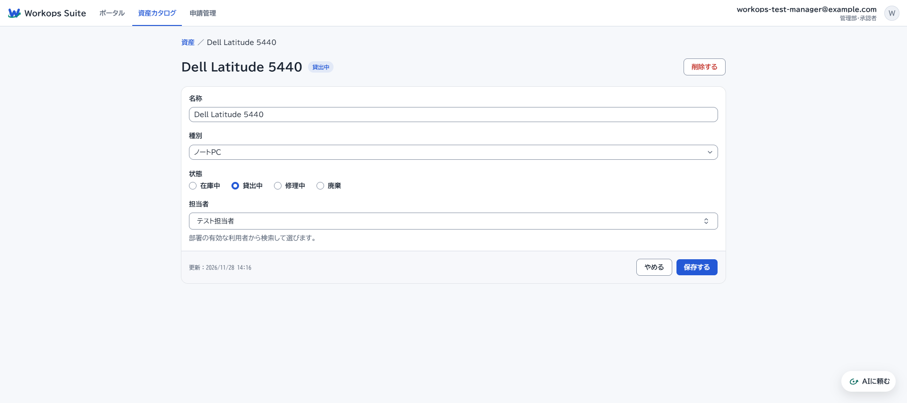
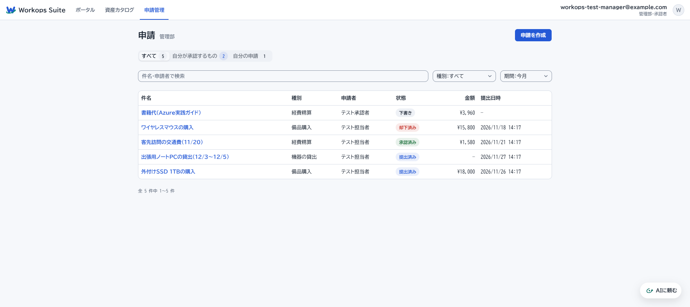
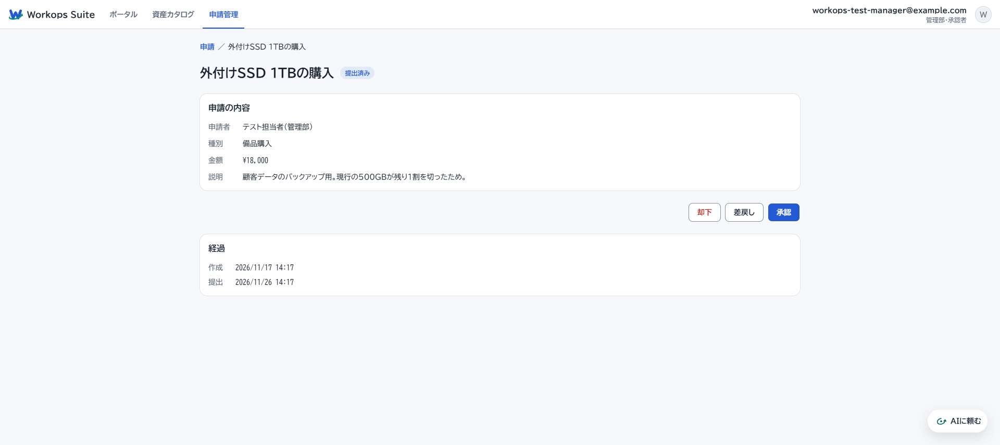
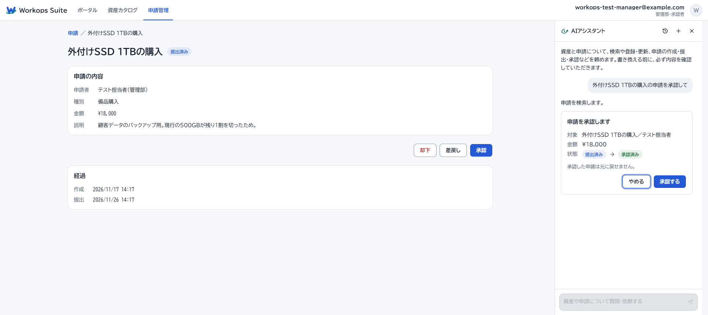

# Workops Suite

ポータル・資産カタログ・申請管理の3つのアプリを、共通のログインと権限で使う業務管理システムです。資産と申請は、画面からも AI への自然言語の依頼からも検索・操作できます。

## 何をする製品か

| アプリ | できること |
| --- | --- |
| ポータル | アプリとページの一覧から各アプリを開きます。全体管理者は、利用者・部署・アプリとページを管理します |
| 資産カタログ | PC・モニター・携帯電話・ライセンスなどの資産を、部署ごとに登録・検索し、担当者と状態（在庫中・貸出中・修理中・廃棄）を管理します |
| 申請管理 | 備品購入・機器の貸出・経費精算などの申請を作成・提出し、承認者が承認・却下・差戻しします |
| AI | 資産カタログと申請管理の画面から、AI に検索や操作を頼めます。同じ操作を MCP サーバーとして公開し、外部の MCP クライアントからも使えます |

操作できる範囲は所属部署とロール（閲覧者・担当者・承認者）で決まります。全体管理者は部署をまたいで管理できます。



### 画面

| アプリ | 画面 | 内容 |
| --- | --- | --- |
| 共通 | ログイン | 共通のログイン画面。一度ログインすれば、ほかのアプリもそのまま使えます |
| 共通 | 所属が未設定 | 部署とロールが設定されていない利用者に、全体管理者による設定が必要なことを伝えます |
| 共通 | 権限がない・見つからない | 権限のない画面と存在しない画面を、区別せずに案内します |
| 共通 | AI パネル | 画面右下の「AIに頼む」から開きます |
| ポータル | ホーム | アプリごとのタイルと、配下のページを並べます。権限のないページは表示しません |
| ポータル | ユーザー一覧・作成・詳細 | 利用者を検索し、作成・所属の設定・招待メールの再送・無効化・削除をします |
| ポータル | 部署管理 | 部署を登録・編集します |
| ポータル | アプリ・ページ管理 | アプリと配下のページを登録・編集します |
| 資産カタログ | 資産一覧 | 名称・担当者で検索し、状態・種別で絞り込みます。一覧から状態を直接変更できます |
| 資産カタログ | 資産の詳細・編集 | 資産の内容をその場で編集します。登録も同じ画面です |
| 資産カタログ | 資産種別管理 | 資産の種別を管理します |
| 申請管理 | 申請一覧 | 「すべて」「自分が承認するもの」「自分の申請」のタブで、件名・申請者で検索します |
| 申請管理 | 申請詳細 | 状態とロールに応じた操作（提出・取下げ・承認・却下・差戻し）を表示します |
| 申請管理 | 申請の作成 | 種別・件名・金額・説明を入力し、下書き保存または提出します |
| 申請管理 | 申請種別管理 | 申請の種別を管理します |









AI に書き換えを頼むと、実行の前に、何をどう変えるかを名前で示す確認カードが出ます。



## なぜ役に立つか

- 3つのアプリを、1つのログインと同じロールで使えます。
- 画面でも AI でも外部の MCP クライアントでも、同じ部署・ロール・本人・状態の条件が、サーバー側で同じように適用されます。
- AI による書き換えは、利用者が確認カードで内容を確かめて実行してから行います。
- AI への入力とツールの結果に含まれるプロンプト攻撃を検知します。

## どう始めるか

### 前提

- Node.js 24
- AWS のアカウントと、デプロイに使うプロファイル（以下の例では `amazon-connect`、リージョンは ap-northeast-1）
- アカウントで1つの CloudTrail の証跡（[利用者の同期と証跡](../../wiki/利用者の同期と証跡)）

### 手順

1. 依存を入れて、lint と型チェックを通します。

   ```powershell
   npm ci
   npm run lint
   npm run typecheck
   ```

2. 共有バックエンドをデプロイします。ユーザープール・Aurora・AI の機能を作り、マイグレーションを適用します。

   ```powershell
   $env:AWS_REGION = 'ap-northeast-1'
   npm run sandbox -- --profile amazon-connect --once
   ```

3. 3つのアプリのバックエンドをデプロイします。共有のユーザープールに、アプリごとのクライアントを作ります。

   ```powershell
   npm run sandbox:portal -- --profile amazon-connect --once
   npm run sandbox:asset -- --profile amazon-connect --once
   npm run sandbox:request -- --profile amazon-connect --once
   ```

4. 各アプリの `.env.local`（`apps/portal`・`apps/asset`・`apps/request`）に、アプリのオリジンを書きます。ポータルは `http://localhost:3000`、資産カタログは `3001`、申請管理は `3002` です。

   ```dotenv
   AMPLIFY_APP_ORIGIN=http://localhost:3000
   ```

5. 最初の管理者とアプリの一覧を登録します。手順は [初期登録](../../wiki/初期登録) にあります。

6. 開発サーバーを起動します。

   ```powershell
   $env:AWS_PROFILE = 'amazon-connect'
   npm run dev:portal
   ```

   資産カタログは `npm run dev:asset`、申請管理は `npm run dev:request` です。`http://localhost:3000` を開くと、共通のログイン画面へ移ります。

構成・DB・デプロイの詳しい手順は [Wiki](../../wiki) にあります。

## どこで助けを得られるか

不具合や質問は [Issues](../../issues) に書いてください。

## 誰が保守しているか

[kyiwanami](https://github.com/kyiwanami)
